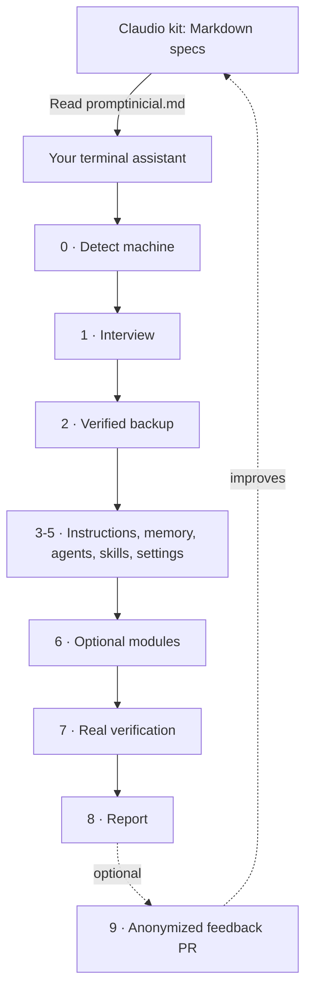

# Claudio

**Turn a freshly installed terminal AI assistant into a personal orchestrator that lives on your
machine, remembers, delegates and builds its own tools.**

[Español](README.es.md)

Claudio is not a chatbot, a wrapper or a prompt pack. It is a **specification kit**: plain Markdown that
your own assistant (Claude Code recommended) reads and *implements on your machine*, adapted to what it
detects there: OS, hardware, runtimes and what you already have installed.

What you end up with:

| Feature | What you get |
|---|---|
| **Persistent memory** | A plain-Markdown vault (Obsidian-style links) of recipes, solved errors, project context and how to brief each subagent. It grows with use. |
| **Orchestration** | The main session decides and integrates; scoped subagents (explorer, implementer, verifier, agent architect) do sweeps and bounded work. |
| **Self-built tools** | When a task keeps repeating, it creates a new agent or skill for it, with frontmatter, permissions and a real test. |
| **Golden rules** | Nothing is "done" without a real test, no swallowed errors, secrets never in chat or code, long jobs detached with logs. |
| **Optional modules** | Graphical privilege elevation + safety hook, automatable browser, auxiliary personas, desktop UI, system audit, local small model, advanced agents. |

## Why a spec kit instead of code

- **Adapts instead of assuming.** Two installs can differ inside; what must match is the behaviour
  described by each section's acceptance criteria.
- **Never destroys your setup.** Existing instructions, memory, agents, skills and hooks are backed up
  (verified), merged and changed only after you see a diff and confirm.
- **Verifiable.** Every phase and module ends with acceptance criteria the assistant must actually run.
- **Updatable by section.** A manifest versions each file; updates apply only what changed, from
  published tags.

## Install

1. Download the [latest release](https://github.com/golosw/Claudio/releases/latest) (*Source code*) and
   unzip it, or `git clone --branch v3.4 https://github.com/golosw/Claudio`.
2. Open your terminal assistant in that folder and type:

   > Read `promptinicial.md` and follow it.

It works on a fresh machine and on an existing setup alike. The assistant interviews you briefly
(name, language, what you use it for) and from then on **answers in the language you choose**. Note:
the kit, and for now the instruction files it generates, are written in Spanish.

## Update

Once installed, ask your assistant to "search for kit updates" (`actualizar` skill). It compares the
published manifest with yours and applies only the changed sections, with your confirmation.

## Status and honesty notes

- **Claude Code** is the reference and the only assistant tested end to end. Adapters exist for
  Codex CLI, Gemini CLI and opencode (**untested**), plus a generic procedure. Whatever a program can't
  do degrades visibly and the final report says so.
- Designed for Linux with a desktop. On macOS or Windows the base phases work; some modules adapt or
  don't apply.
- Tested installs so far are in Spanish; answering in another language is supported by the
  interview but not yet verified.

## Structure

| Path | What it is |
|---|---|
| `promptinicial.md` | Entry point |
| `MANIFIESTO.md` | Sections, per-section version, mandatory or optional |
| `fases/` | Install phases 0-9 |
| `adaptadores/` | Per-assistant translation (paths, formats, capabilities) |
| `modulos/` | Optional modules M1-M8 |
| `plantillas/` | Templates: permanent instructions, feedback report |
| `aportaciones/` | Feedback reports sent by users |
| `actualizar.md` | Update flow from this repository |
| `CAMBIOS.md` | Changelog |

## Contribute

At the end of an install or update, the assistant offers to write a feedback report: your system,
what failed or the kit didn't foresee, and (on update) what your setup has that could help others.
It's anonymized, you review all of it, and if you want it's sent as a pull request to `aportaciones/`.
Nothing leaves your machine without your confirmation.

## Security

Every change on your machine is shown as a diff and needs your confirmation. Updates come only from
published tags, never from `main`.

## License

[MIT](LICENSE)
